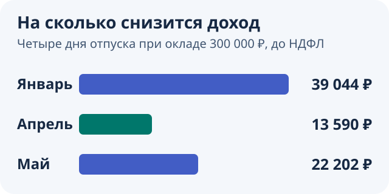

Каждый ноябрь ко мне приходит работодатель с одним и тем же вопросом: «Когда планируешь отпуск в следующем году?»

А я откуда знаю? На дворе ещё ноябрь, а меня уже просят определиться, когда я буду отдыхать через полгода или даже через год.

Конечно, в IT с этим обычно проще. Запланированные даты не высечены в камне: их можно перенести, если договориться с работодателем. Но есть нюанс: если нужный период уже заняли коллеги, поменять планы будет сложнее.

С годами я научился хотя бы примерно планировать отдых заранее. Зимой хочется куда-нибудь на лыжи, летом — купаться. Есть дни рождения, семейные планы и соревнования по парапланеризму. Всё это позволяет накидать приблизительный график.

А вот что делать с оставшимися отпускными днями — каждый год новая головоломка.

В этом году у меня была запланирована всего одна поездка. Остальные дни предстояло распределить так, чтобы получить максимум отдыха и по возможности не потерять слишком много денег.

Я поискал в интернете удобный калькулятор, который помог бы с этой задачей. Ничего подходящего для себя не нашёл. Поэтому сделал собственный.

[**Попробовать калькулятор отпусков на 2027 год**](/tools/vacation-2027/#vacationInputs)

Но сначала расскажу, как вообще выбирать даты, почему иногда выгоднее работать, пока все отдыхают, и сколько денег можно потерять из-за четырёх неудачно выбранных дней.

## Что выгоднее: деньги или отдых?

На самом деле здесь три разные стратегии.

**Первая — получить больше денег.** Выбирать месяцы с большим количеством рабочих дней. Некоторые пытаются дополнительно оформить отпуск на выходные, хотя у такой схемы есть юридические ограничения — о них ниже.

**Вторая — получить максимум отдыха.** Присоединять отпуск к праздникам, чтобы за три-четыре отпускных дня отдыхать восемь-десять.

**Третья — найти баланс.** Сначала запланировать поездки и важные события, а оставшиеся дни распределить так, чтобы отдыхать подольше и потерять поменьше.

Лично я всегда склонялся ко второй и третьей стратегиям.

Я прекрасно знаю, что отпуск может уменьшить доход за месяц. Но для меня провести время с семьёй, съездить в путешествие или полетать на параплане важнее, чем выжать максимум денег из календаря.

Хотя иногда и во мне просыпается бухгалтер.

## Почему я однажды отказался от отпуска в мае

Был у меня случай, когда я сознательно решил не брать отпуск на майские праздники.

Причина банальная: деньги.

В мае обычно мало рабочих дней, а значит, каждый из них при фиксированном окладе стоит дороже. Уходить в отпуск в такие дни финансово не слишком приятно.

Я прикинул, сколько потеряю, и решил, что лучше поработаю.

Тем более многие коллеги как раз собирались отдыхать. А это отдельное удовольствие: меньше созвонов, меньше отвлекающих сообщений, никто постоянно не дёргает по мелочам. Можно наконец спокойно заняться работой.

Поэтому иногда стратегия «не отдыхать, когда отдыхают все» оказывается вполне разумной. И деньги сохраняешь, и работаешь в относительно спокойной обстановке.

Но насколько именно дороже обходится отпуск в мае или январе? Давайте посчитаем.

## Лучшие месяцы для отпуска в 2027 году по деньгам

При фиксированном окладе в первую очередь стоит смотреть на **март, апрель, июль, август, сентябрь и декабрь**. В каждом из этих месяцев 2027 года по 22 рабочих дня.

Почему это важно?

Допустим, ваша зарплата — **300 000 ₽ в месяц до НДФЛ**.

В январе 2027 года всего 15 рабочих дней. Получается, один рабочий день в пересчёте на оклад стоит:

**300 000 / 15 = 20 000 ₽.**

А в апреле 22 рабочих дня:

**300 000 / 22 ≈ 13 636 ₽.**

Разница приличная.

Теперь самое интересное: отпускные считают не по стоимости рабочего дня в конкретном месяце, а по среднему заработку за расчётный период — обычно 12 календарных месяцев перед месяцем начала отпуска.

Если весь этот период полностью отработан, зарплата не менялась и учитываемых премий не было, получаем:

**300 000 / 29,3 ≈ 10 239 ₽ за календарный день отпуска.**

Это упрощённый пример по правилам [постановления Правительства РФ от 24.04.2025 № 540](https://www.consultant.ru/document/cons_doc_LAW_504093/). Для неполных месяцев и некоторых премий расчёт сложнее.

Теперь сравним, сколько начислят за месяц, если взять четыре рабочих дня отпуска в январе, апреле и мае. В каждом примере отпуск длится ровно четыре календарных дня и не захватывает соседние выходные.

| Даты отпуска | Рабочих дней в месяце | Доход за месяц до НДФЛ | Меньше обычного оклада на |
|---|---:|---:|---:|
| [11–14 января](/tools/vacation-2027/?example=january-pay) | 15 | **260 956 ₽** | **39 044 ₽** |
| [5–8 апреля](/tools/vacation-2027/?example=april-pay) | 22 | **286 410 ₽** | **13 590 ₽** |
| [4–7 мая](/tools/vacation-2027/?example=may-holidays) | 19 | **277 798 ₽** | **22 202 ₽** |

В таблице **зарплата за отработанные дни плюс отпускные**. Суммы округлены до рубля.

Например, за январь: `300 000 × 11 / 15 + 4 × (300 000 / 29,3) ≈ 260 956 ₽`.

Получается, за апрель начислят примерно на **25 455 ₽ больше, чем за январь**, хотя в обоих случаях потрачены одинаковые четыре дня отпуска.

Вот почему я стараюсь избегать январских отпусков, если на них нет особых планов. Но календарь каждый год разный. В марте 2027 года, например, 22 рабочих дня, поэтому он вполне подходит для отпуска с финансовой точки зрения.

**А сколько это будет на руки?** При окладе 300 000 ₽ важно учитывать прогрессивный НДФЛ: по [действующей шкале](https://www.nalog.gov.ru/rn64/news/activities_fts/16639359/) первые 2,4 млн ₽ за год облагаются по ставке 13%, а сумма сверх 2,4 млн ₽ и до 5 млн ₽ по ставке 15%. Если получать 300 000 ₽ каждый месяц без отпусков, премий и вычетов, получится 3 600 000 ₽ за год до налога и **3 108 000 ₽ после НДФЛ** (492 000 ₽ налога). Сумма на руки за конкретный месяц зависит в том числе от накопленного дохода с начала года и фактических дат выплат.

[Сравнить январь, апрель и май в калькуляторе](/tools/vacation-2027/?example=compare-pay)

## Как получить десять дней отдыха за четыре дня отпуска

Вот эту стратегию я люблю гораздо больше.

Смысл простой: найти праздники, к которым можно присоединить несколько отпускных дней.

Например, в мае 2027 года можно взять отпуск **с 4 по 7 мая**. [Открыть 4–7 мая в калькуляторе](/tools/vacation-2027/?example=may-holidays).

Тогда **1–3 мая** — выходные и праздник, **4–7 мая** — отпуск, **8–10 мая** — опять выходные и праздник. Итого **10 дней отдыха подряд**, а отпускного остатка потрачено всего четыре дня.

На работу — 11 мая.

При окладе 300 000 ₽ начисления за май с таким отпуском составят около **277 798 ₽ до НДФЛ**.

Для меня такой вариант привлекательнее, чем просто взять четыре произвольных дня посреди месяца.

Если оформить отпуск с 4 по 10 мая включительно, из остатка уйдут **шесть календарных дней**. В отпуск войдут суббота 8 мая и перенесённый выходной 10 мая. Нерабочий праздничный день 9 мая не засчитают. Выходить на работу всё равно 11 мая.

## А что с январём?

Январь — один из самых дорогих месяцев для отпуска при фиксированном окладе. Но если цель — длинные каникулы, и здесь есть интересный вариант.

Возьмите отпуск **с 11 по 15 января 2027 года**. Вместе с новогодними каникулами и выходными 16 и 17 января получится **17 дней отдыха подряд с 1 по 17 января** за пять дней отпуска. Если считать [выходной 31 декабря 2026 года](https://static.government.ru/media/files/4jeB8hNKm69ggOa9yDiYOli6YoAyM21i.pdf), получится 18 дней. На работу в понедельник, 18 января.

При окладе 300 000 ₽ начисления за январь составят около **251 195 ₽ до НДФЛ**, то есть на **48 805 ₽ меньше** обычного оклада.

В обязательную 14-дневную часть отпуска этот вариант не засчитывается: сам отпуск длится только пять дней.

[Посчитать отпуск с 11 по 15 января](/tools/vacation-2027/?example=january-long)

## Ещё несколько удачных дат в 2027 году

| Взять отпуск | Отдых подряд | Потратить дней отпуска |
|---|---|---:|
| [24–26 февраля](/tools/vacation-2027/?example=february-holidays) | 21–28 февраля, **8 дней** | **3** |
| [15–18 июня](/tools/vacation-2027/?example=june-holidays) | 12–20 июня, **9 дней** | **4** |
| [1–3 ноября](/tools/vacation-2027/?example=november-holidays) | 30 октября – 7 ноября, **9 дней** | **3** |

Обычные и перенесённые выходные, попавшие внутрь оформленного отпуска, расходуют его календарные дни. А нерабочие праздничные дни из отпуска исключают. Основание — [статьи 112](https://www.consultant.ru/document/cons_doc_LAW_34683/98ef2900507766e70ff29c0b9d8e2353ea80a1cf/) и [120 ТК РФ](https://www.consultant.ru/document/cons_doc_LAW_34683/1ea2cd88521106bc484f44be9e24fa81034d13e5/).

Если хотите, чтобы автоподбор рассмотрел короткие майские и ноябрьские периоды, откройте «Больше настроек» и установите «Минимум дней в части» на три дня. По умолчанию подбор рассматривает части от пяти дней.

## Как устроить себе четырёхдневную рабочую неделю

Есть ещё одна стратегия, которая мне особенно нравится для лета: не уходить в длинный отпуск, а **устроить себе четырёхдневку на несколько недель**.

Идея простая: согласовать с работодателем отпуск по одному рабочему дню в неделю. Например, каждый понедельник, среду или пятницу.

- **Понедельник.** Три выходных подряд, а рабочая неделя начинается со вторника.
- **Среда.** Два дня поработал, один отдохнул, ещё два поработал — и снова выходные.
- **Пятница.** Уже вечером в четверг можно уехать с палатками на речку. Впереди три дня отдыха и две ночи на природе вместо одной.

За четыре обычные рабочие недели потратите **четыре календарных дня отпуска**. Если выбранный день и так выходной, отпуск на него не нужен. А в некоторых месяцах нужный день недели встречается пять раз.

По деньгам всё зависит от месяца и среднего заработка. За дни отпуска начислят отпускные, а зарплату за отработанное время уменьшат на стоимость пропущенных рабочих дней. Именно поэтому я и сделал калькулятор: хочется сразу увидеть, сколько будет на руки, а не гадать, сильно ли ударит по бюджету такой режим.

Например, [возьмём все рабочие пятницы с июня по август](/tools/vacation-2027/?week=friday&from=6&to=8#vacationFourDay). Понадобится **13 дней отпуска**. При окладе 300 000 ₽ и без премий доход за год на руки снизится примерно на **40 326 ₽**. В калькуляторе можно поменять день недели, месяцы и оклад.

Есть ограничение: деление ежегодного оплачиваемого отпуска на отдельные дни **нужно согласовать с работодателем**, и хотя бы одна его часть должна оставаться продолжительностью не менее 14 календарных дней. Это предусмотрено [статьёй 125 ТК РФ](https://www.consultant.ru/document/cons_doc_LAW_34683/befc35b415ff7b334824418693252b451205ffc0/).

Лично мне эта идея нравится тем, что отпуск превращается не в одну большую поездку, а в целый месяц с более свободным ритмом. Летом такое может оказаться даже приятнее, чем привычная неделя отдыха.

## Можно ли брать отпуск только на выходные и получать больше денег?

Есть ещё одна любопытная стратегия. Я лично так никогда не делал, но о ней давно знаю.

Если оформить часть ежегодного оплачиваемого отпуска на субботу и воскресенье, за эти календарные дни начислят отпускные. При этом рабочие дни недели останутся отработанными, а зарплата за них не уменьшится. Сумма начислений за месяц может оказаться выше обычного оклада.

Но бесплатных денег здесь нет: вы тратите **два дня из своего отпускного остатка** и по существу меняете потенциальный отдых на выплату.

Разделить отпуск на части можно только по соглашению с работодателем. ТК РФ не запрещает начинать отдельную часть отпуска в выходной. В [письме от 07.12.2018 № 14-2/ООГ-9754](https://ohranatruda.ru/upload/iblock/388/Pismo-Mintruda-Rossii-ot-07.12.2018-_-14_2_OOG_9754.pdf) Минтруд указал, что предоставлять ежегодный отпуск исключительно в выходные неправомерно.

Кроме того, по [статье 125 ТК РФ](https://www.consultant.ru/document/cons_doc_LAW_34683/befc35b415ff7b334824418693252b451205ffc0/) **хотя бы одна часть ежегодного оплачиваемого отпуска должна составлять не менее 14 календарных дней**.

Мне такой подход не особенно близок. Отпуск всё-таки нужен, чтобы отдыхать.

## Лайфхак с обязательными 14 днями отпуска

Есть ещё одна вещь, на которую стоит смотреть при выборе дат.

Обычно в двухнедельный отпуск при пятидневке попадают **10 рабочих дней и 4 выходных**. Но из-за переноса выходных иногда возникает шестидневная рабочая неделя. Тогда можно подобрать 14 календарных дней так, чтобы внутри оказалось **11 рабочих дней и только 3 выходных**.

Конкретный пример на 2027 год: [отпуск 8–21 февраля](/tools/vacation-2027/?example=february-long). Суббота **20 февраля будет рабочей** из-за переноса выходного на 22 февраля. В отпуск попадут 11 рабочих дней и три обычных выходных: 13, 14 и 21 февраля. С учётом выходных 6–7 февраля и нерабочих дней 22–23 февраля получится **18 дней отдыха за 14 дней отпуска**. На работу 24 февраля.

Так за 14 дней отпуска можно пропустить на один рабочий день больше, чем в обычные две недели. При этом зарплата за отработанное время уменьшится сильнее.

Важно отдельно учитывать нерабочие праздничные дни: они не входят в число календарных дней ежегодного оплачиваемого отпуска.

## Сколько рабочих дней в 2027 году

Для пятидневной рабочей недели в 2027 году **247 рабочих дней и 118 выходных и праздничных**.

| Месяц | Рабочих дней |
|---|---:|
| Январь | 15 |
| Февраль | 19 |
| Март | 22 |
| Апрель | 22 |
| Май | 19 |
| Июнь | 21 |
| Июль | 22 |
| Август | 22 |
| Сентябрь | 22 |
| Октябрь | 21 |
| Ноябрь | 20 |
| Декабрь | 22 |

В 2027 году выходные перенесены **со 2 января на 5 ноября**, **с 3 января на 31 декабря**, **с 20 февраля на 22 февраля**. Суббота 20 февраля — рабочая, но сокращённая на час.

Источники: [постановление Правительства РФ от 17.09.2026 № 1187](https://www.consultant.ru/document/cons_doc_LAW_544706/) и [производственный календарь на 2027 год](https://www.consultant.ru/law/ref/calendar/proizvodstvennye/2027/).

## Почему я решил сделать собственный калькулятор отпусков

Каждый год у меня есть несколько периодов, которые я могу более-менее точно запланировать. Но остаются и свободные дни.

Иногда накапливается отпуск с прошлого года. Иногда появляются дополнительные дни. А иногда я отменяю уже запланированный отпуск: поездка сорвалась, передумал куда-то ехать или понял, что сейчас нужнее на проекте. Не в ущерб семейным планам, конечно.

И каждый раз приходится решать одну и ту же задачу: куда поставить оставшиеся дни, чтобы получить максимум пользы?

Можно открыть производственный календарь, Excel, калькулятор зарплаты и потратить вечер на перебор вариантов. А можно поручить расчёты алгоритму.

Я хотел сделать именно второй вариант.

В итоге получился [калькулятор отпусков на 2027 год](/tools/vacation-2027/#vacationInputs), в котором можно:

- Указать оклад до НДФЛ, премии и доступное количество отпускных дней.
- Отметить поездки и обязательные даты отдыха.
- Указать периоды, когда отдыхать не хочется.
- Автоматически распределить оставшиеся дни по выбранной стратегии.
- Рассчитать четырёхдневную неделю на выбранные месяцы.
- Посмотреть, как отпуск повлияет на доход по месяцам и на сумму на руки.
- Распечатать результат на А4, обсудить планы и сделать пометки карандашом.

Последний пункт мне особенно нравится. После всех автоматических расчётов получается обычный понятный календарь, который можно использовать для планирования реальной жизни.

Главная ценность инструмента для меня — **получить максимально выгодный вариант за минимальное время**. Не сравнивать десятки комбинаций вручную, а ввести свои условия, выбрать стратегию и посмотреть результат.

## Насколько точные расчёты в калькуляторе?

Сразу оговорюсь: это инструмент планирования, а не бухгалтерская программа.

Отпускные зависят от среднего заработка за расчётный период. За это время вы могли болеть, получать премии, ходить в отпуск, получать повышение или работать неполный месяц. Всё это влияет на итог.

Калькулятор позволяет указать известные премии, но не восстанавливает всю историю выплат за предыдущий год. Он ориентирован на стандартную пятидневку и федеральные праздники. Региональные праздники, сменный график, больничные, изменения оклада и налоговые вычеты могут не учитываться.

Поэтому я не обещаю точности до рубля. Но для сравнения вариантов и приблизительной оценки дохода инструмент полезен.

Ещё нюанс: в календаре отпускные отнесены к датам отпуска, чтобы было удобно сравнивать месяцы. На практике деньги приходят раньше: по [статье 136 ТК РФ](https://www.consultant.ru/document/cons_doc_LAW_34683/a0a891ee650687026ef53d5d1194983419be6793/) отпуск оплачивают **не позднее чем за три дня до его начала**.

## Как я предлагаю планировать отпуск на 2027 год

Мой подход довольно простой.

Сначала отмечаю всё, ради чего отпуск действительно нужен: поездки, важные события, соревнования, семейные планы.

Потом смотрю, сколько дней осталось, и позволяю калькулятору подобрать наиболее выгодное распределение.

Не обязательно выбирать исключительно финансовую выгоду. Можно сосредоточиться на длинном отдыхе, присоединении к праздникам или более равномерном распределении дней по году.

Дальше остаётся проверить, насколько получившийся вариант подходит к реальной жизни, и при необходимости передвинуть даты вручную.

Всё-таки никакой алгоритм не знает лучше вас, когда хочется поехать на море, покататься на лыжах или просто ничего не делать.

Я сделал этот инструмент для себя, потому что устал каждый год решать одну и ту же задачу вручную. А теперь хочу поделиться им с остальными.

Мне вообще нравится делать жизнь людей проще и комфортнее. Если мой калькулятор сэкономит вам пару часов и поможет получить несколько дополнительных дней отдыха, значит, делал его не зря.

**[Рассчитать свой отпуск на 2027 год](/tools/vacation-2027/#vacationInputs)**
